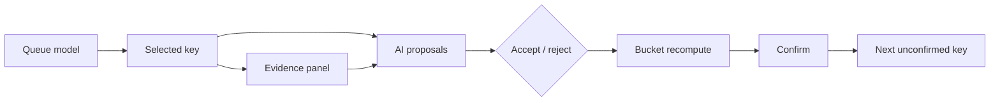

# Demo architecture

The demo is intentionally dependency-free so the interaction model is easy to inspect.

## State model

A key has:

- `source` and `target` (plus an `effectiveTarget` derived from accepted or edited proposals)
- zero or more AI proposals
- an indexed human review state for each proposal (`pending`, `accepted`, `rejected`) and optional inline edit override
- evidence: rationale, corpus rows, glossary terms, consistency signal
- `confirmed`

The visible bucket is derived from active proposals:

| Active proposal | Bucket |
| --- | --- |
| Critical / Major / Minor | Problem |
| Preferential only | Preferential |
| None | Clean |

Confirm is disabled while any proposal is still pending. Confirming records the key and moves focus to the next unconfirmed key in the current queue.

## Why this is a useful portfolio piece

The interesting part is not the visual treatment alone; it is the interaction contract:

1. AI suggestions are reviewable objects, not opaque text.
2. Evidence is adjacent to the decision.
3. Queue order is derived from the decision state.
4. Confirmation has a predictable destination.
5. Keyboard shortcuts mirror the visible actions.

All content in this demo is synthetic.
